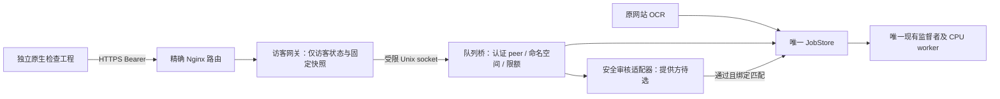

# 第二阶段原生 OCR 接入方案（2026-11-04，待评审）

本轮交付为方案、协议增补草案和验证记录，不是可安装发布包。没有新增运行代码、启用图片策略、外发图片、开通服务、操作服务器或微信后台。用户选择“尚未选择，先给接入方案”；账号/B–E、体验版上传、提审、发布不在范围。

## 当前事实与证据边界

- 用户本轮回交：第一阶段真实微信访客和双服固定快照已通过开发者工具，且“诊断版2手机上也通过了”。这是用户验收反馈；没有机型/系统版本，不扩展为双系统、相册上传或 OCR 验收。旧第一阶段文档的“待 SDK/手机验证”仅为当时状态。
- 第一阶段固定源码 `0b97dae9e1003c1bc2c4c5b7a189b81cb4002112`，交付 `9d856fba3f6b825b255bc17e`，origin `https://mini-test.racepick.cn`。实际服务器本轮未重新访问，不把文件记录当作实时采样。
- 网站运行的最近运维记录必须读主 repo 的 `docs/CLOUD_HANDOFF.md`：a933 已上线验收并完成 global-profile0→1 和维护数据发布。730a61 是历史交付；本轮已重新核验其外层 SHA、59项目录清单、主包168文件/兼容包158文件及冻结绑定通过，不能因此拿它替换 a933 或重跑迁移。
- 当前第一阶段 `backend.mini_guest_service.GuestOnlyGateway` 只允许 POST session / GET snapshot，硬要求 image_policy=disabled，OCR 返回404。它不加载模型、不连接正式账号或队列。
- `backend.mini_auth.load_config` 当前仅支持 disabled/private_unmoderated；`backend.mini_api` 的 catalog/snapshot 仅在 private_unmoderated 下提供识图能力，catalog 固定返回 content_safety=not_integrated。**没有可用于本阶段的安全提供方实现。**
- `mini_api` 的 lookup/recovery/upload 直接调用 `service.store.connect()` 查询 jobs；因此不能只传一个远程 service 对象或只增加 Nginx 路由。必须先抽出队列端口，替换这些直接 SQL 访问。
- `JobStore.create` 已有共享8任务、每owner2任务、owner/IP每600秒20次、原key幂等和入队事务；生产 worker 从同一队列 claim，使用任务内 catalog 识别。监督者是唯一模型进程的拥有者。
- 本机 Docker Linux 引擎连接失败；本轮没有启动 Docker/WSL，也没有新的 Linux/socket/systemd/Nginx 隔离通过证据。既有容器 CPU OCR 和 fixture 成功只属历史证据。

## 建议架构：隔离访客网关 → 受限本机队列桥 → 唯一 JobStore / worker

此图是待实现方案，不代表现有链路。模型仍只由原监督者加载；队列桥与安全适配器不创建 RecognitionService 本地 worker，不调用网页 Cookie 接口。

1. 访客进程保持独立 UID、既有 GuestStore 和固定五文件，不能挂载正式 `/var/lib/racepick`、`/etc/racepick`、队列 SQLite 或媒体目录。仅允许访问拟新增 `/run/racepick-ocr-bridge/guest.sock`，不能赋予访客 UID 对原队列目录的读写权限。
2. 队列桥是单独受限进程，拥有队列文件权限但挂载视图仅露出 OCR 根目录、固定目录清单及 socket；隐藏正式业务库、SMTP、score-state、微信密钥。采用 SO_PEERCRED 验证明确允许的 UID；socket 非公开 TCP，目录0750/socket0660，不依赖客户端自报 UID。UID/路径需未来现场核验，不硬写历史值执行。
3. socket 仅允许 admission/create/recover/get/cancel/health；拒绝任意SQL、路径、URL、shell、worker启动和网页owner查询。消息包含固定版本、严格字段、最多8KiB头及长度限定的二进制图像，拒绝多帧尾部、长度不符、越界和半包；不用可执行反序列化，不传base64膨胀体。
4. owner由已认证访客会话推导并在桥内强制限定 mini-v1 命名空间，禁止接受网页owner。请求id本身不构成授权；get/cancel/recover均重验peer、owner、CN目录。原生端不能读取网页任务，也不能换token继承旧任务。
5. 可信IP只取受信回环反代覆盖后的 X-Real-IP，统一正规化，桥内部使用与网页完全相同的 `sha256('ocr-client:'+ip)`。不能使用小程序自报IP或原始XFF，也不能另建20次额度。
6. 将 JobStore 的 get/recover/create/cancel/容量查询抽成队列端口，网页使用本地适配器、原生使用socket适配器；保留原网页身份/路由。配额判定与正式入队在共享事务中完成；前置读取检查不能代替最终事务。
7. 新安全待审也占共享8任务/owner2任务，不能成为第9条旁路。共享事务登记 reservation，再收图、审核；网页创建也须计入未到期 reservation。转为正式 queued 时原子消费 reservation，不重复计费；拒绝/超时释放容量但保留有界的尝试限额记录。计费、租约、进程崩溃补偿必须先做并发测试，不能靠两个库的顺序写模拟原子性。
8. 每任务保存不可变的固定CN目录及版本，桥仅接受已绑定快照清单重建的maps，拒绝客户端提供maps。正式网站任务继续绑定正式活动目录；原生使用独立固定快照，不修改正式指针。

## 图片安全：先固定可替换适配器，不选定未经核验的服务

安全门禁必须位于 CPU OCR claim 之前；解码校验不是内容审核。建议使用独立的 quarantine/admission 记录，安全未通过的媒体对 worker 不可领取；不得先把普通 queued 行写进旧 JobStore 再异步补审核标志，旧worker会立即领取。

审核通过必须绑定图像SHA、server、catalog_version、owner+request_key、租约和策略版本；任意一个不符都不能复用。审核回调需认证、防重放、到期校验；不接受客户端“已审核”字段。取消/过期后回调和OCR结果均不得重新发布，安全异常采取关闭门禁处理。

| 候选 | 接入形态及影响 | 选择前必须取得的材料 |
|---|---|---|
| 支持直接二进制送审的托管图片审核 | 单独出站适配器，避免公开媒体URL；仍会向提供方外发图片 | 官方API/权限、覆盖类别、8MiB/16M支持、地区与留存/删除政策、费用/配额、超时/回执验证、是否要求平台身份 |
| 微信官方图片审核方案 | 仅作候选，不能假设旧接口或当前异步接口适用 | 当期官方接口权限与参数、同步/异步限制、是否需要媒体URL/回调/明文平台身份；本轮官方文档页面访问失败，不能用第三方示例补成已核实规格 |
| 自托管内容安全系统 | 图片可留在自有环境，但会新增模型/资源与维护，不等于现有OCR模型能审核 | 实际模型/类别/测试集/误拒策略、资源容量、隔离、升级责任、平台声明依据；不得在当前小内存主机自动新增模型 |

建议先评估“直接二进制送审”的提供方是否满足要求，再比较微信方案；尚未选择，也没有外发授权。这不是提供方推荐或合规结论。需要外部媒体URL/明文OpenID的方案，会改变当前“无公开媒体URL/仅保存身份摘要”的边界，必须重新评审，不能逆推HMAC或默默保留OpenID。

每家候选填写：服务名称/API版本、凭据归属、数据去向、实际送审内容、处理时点、最长保留、删除能力、失败方式、收费与限额、审核覆盖范围、平台隐私声明。未确定项不得写“已审核/不外发/即时删除”。在服务确定且获得接入授权前，配置仍disabled，snapshot仍false/null，上传404。

## 留存、取消与回退提案

- 未选图、拒绝或取消相册：不上传，继续手选。上传前客户端展示真实用途及未来选定的外发/留存说明，不提前宣称仅在本机处理。
- 网关仅有界读入，最大8MiB图片、64KiB封装；优先流式传桥，避免8份完整body加解码同时落在128MiB访客进程。像素解码和审核在独立受限进程，需实测峰值，现有128MiB/25%配额不能照抄成通过证明。
- 待审图片私有暂存；拟安全处理截止60秒，失败/拒绝/取消立即撤销worker可见性并删除本地媒体。审核通过后原图也最多保留至任务创建起1小时，结果同界；原key/状态元数据另10分钟。实际删除失败必须记录非敏感事件并重试，不声称停机时准点删除。外部服务留存依最终合同说明。
- 不返回私人图片URL、原始OCR文本、boxes或diagnostics；只保留5槽地图结果。必要审计只含不透明任务ID、状态/策略版本/耗时，不含token/code/OpenID/IP明文、原图或OCR无关文本。尝试与配额摘要记录也按有界期限清理。
- 关闭OCR须先禁新上传和capability，再取消/终结本阶段未完成任务；查/取消旧任务提供有界收尾窗口，不重新开放create。保留session/snapshot/手选。须设计独立kill-switch，不能一关catalog就让旧任务不可查询/取消。
- 不回退正式账号库、成绩指针或第一阶段会话库；旧会话不续期。新队列字段/表采用增量显式迁移；先测试旧worker及网页是否兼容，否则未来按用户授权协调网站版本升级，禁止旁路改现网队列。

## 路由与边缘配置提案（非安装脚本）

origin继续建议 `https://mini-test.racepick.cn`，这是第一阶段已验收入口，并非OCR已开证明。保留现行session4KiB限制和request域名；OCR精确白名单见[协议增补草案](MINI_OCR_STAGE2_PROTOCOL_DRAFT_20261104.md)。Global继续false/null/403。账号/B–E及所有其他路径404，DELETE session本阶段仍不新增。

只有精确POST jobs允许8454144字节请求体；静态/其他API/session不放宽。Nginx禁请求体磁盘缓冲，应用与桥均累计字节和总时限；并发预检要在读体前，仍以最终共享事务为准。session/snapshot沿用既有独立5r/s burst10；OCR拟独立2r/s burst4边缘预算，额外原生IP300/分钟、会话120/分钟、owner/IP20任务/600秒、读取全局8/owner2继续受限，不能吃掉原站业务/统计预算。

拟定读取总截止20秒、读取租约30秒；Nginx client_body_timeout20秒只是两次读之间限制，不能冒充总截止。排队截止120秒、安全截止60秒、CPU45秒、模型启动120秒/5分钟最多3次重启沿原监督者约束；安全等待与OCR排队分别计时。上传仅异步202，不让Nginx等OCR结束；上游上传响应拟25秒，查询/取消5秒。Linux中核验反代超时确实覆盖慢传/断流，不只做语法检查。

继续拒绝Cookie/Origin/OPTIONS，精确Host、回环peer、HTTPS与可信IP，不加CORS、不传网页Cookie；所有JSON与边缘错误no-store，不把query/token写access log。平台内容安全回调若需要公网入口，另做鉴权及范围授权，不能夹在此次OCR客户端路由内。

## 分阶段完成条件

1. 本次：保存方案、草案、验证记录和用户第一阶段验收范围；提供方/接入机制未定，公网OCR关闭。
2. 提供方材料齐全并确定授权边界后：网站分支实现队列端口/socket桥/安全门禁及关闭收尾。先独立临时目录、mock审核、不向外部传图；客户端由用户转交草案，确认新增字段后再接线。
3. 新Linux隔离环境：真Unix peer凭据/挂载隐藏/单监督者/共享并发配额/断流/取消/安全回调/进程崩溃/资源峰值/原站延迟；结果分别标Windows、Linux、现场。当前无新Linux证据，不可跳过。
4. 固定干净提交、数据来源、协议SHA、完整包/manifest/外层SHA、升级与关闭回退兼容报告。当前无OCR提交/交付ID，不能借用第一阶段9d856。
5. 需要服务器时，用户执行一个只读核验步骤并回传，核对现行版本/原队列/备份/资源。任何暂存安装、服务/反代/队列schema改变和切换另获授权逐步推进，不重复global-profile或维护迁移。
6. 服务端准备完成才回交非秘密材料，由用户登记uploadFile域名，独立OCR检查工程先工具后手机。单台手机通过仍不等于iOS/Android双系统通过。账号在OCR阶段验收之后另行处理。

## 本轮验证与待核

实际命令/结果及源码哈希见 `MINI_OCR_STAGE2_PREPARATION_RECEIPT_20261104.json`。本轮既有协议回归不证明新桥/新安全处理实现。新架构实现、安全提供方、Linux证据、新交付、现场开关/配置及OCR手机验收均待完成。没有提交推送/合main、服务器命令执行、公告、清理或监控。
